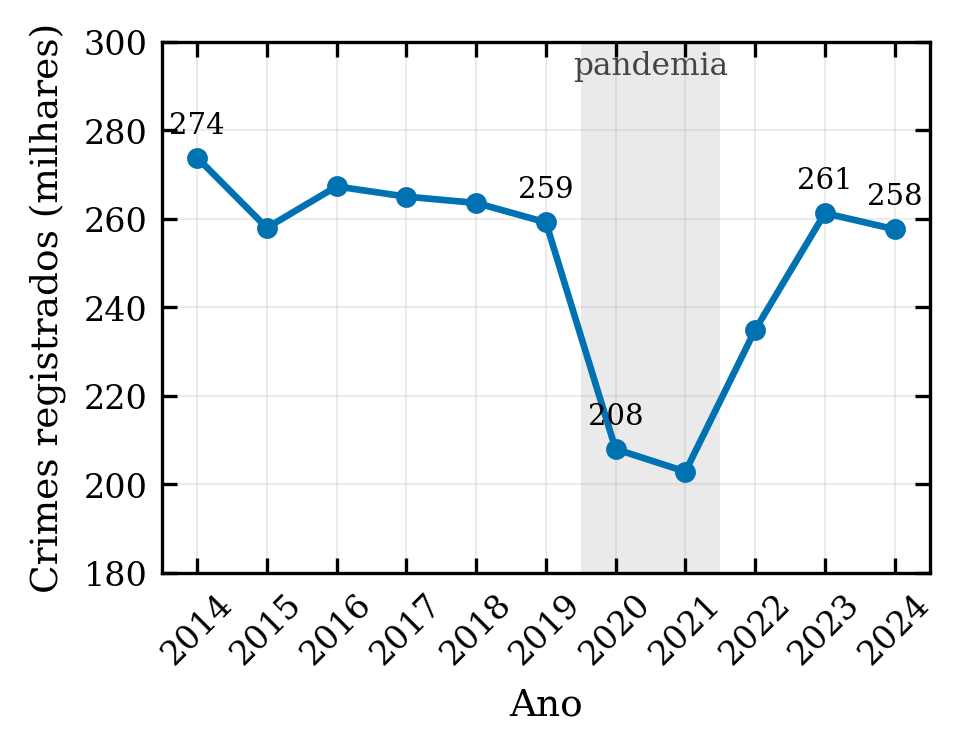
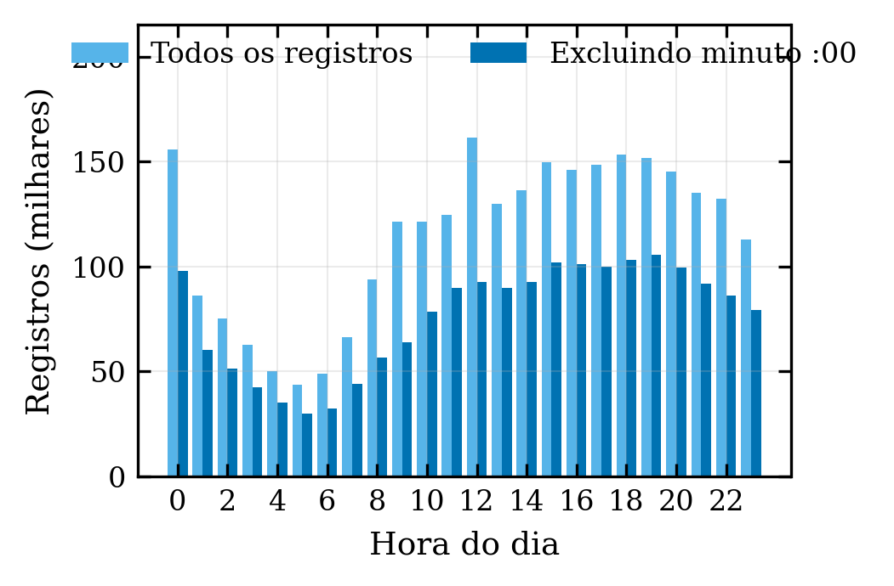
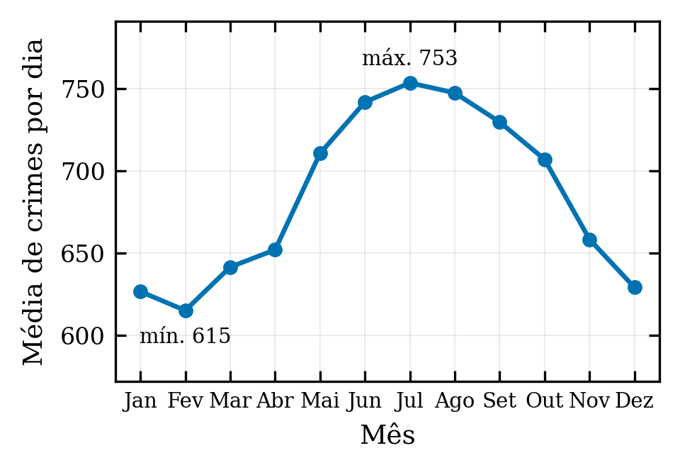
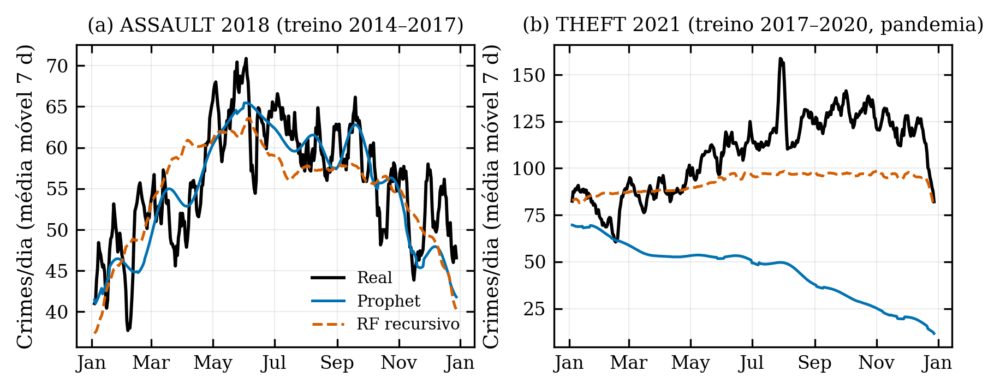
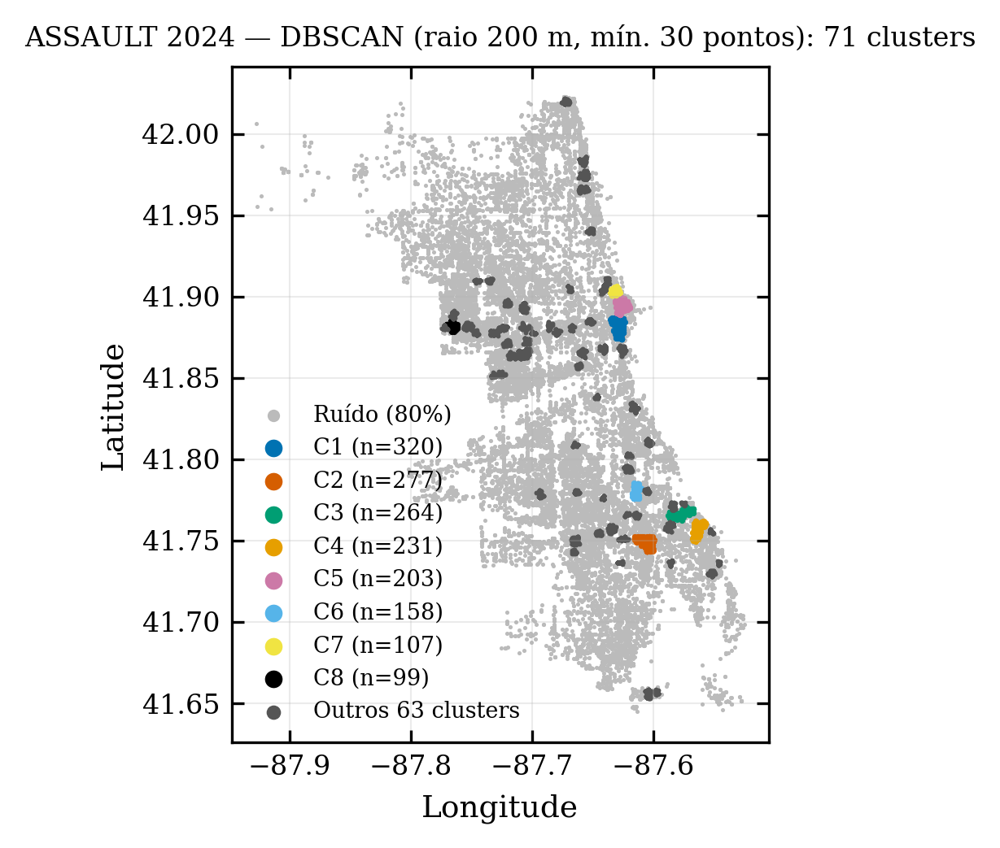

# 1. Introdução

A previsão de ocorrências criminais a partir de registros históricos tornou-se uma ferramenta corrente de planejamento policial, da alocação de efetivo ao mapeamento de áreas de risco [1, 2]. Em grandes centros, o volume de dados abertos permite comparar métodos estatísticos clássicos e algoritmos de aprendizado de máquina, e revisões recentes apontam Random Forest, redes neurais e modelos aditivos como os mais empregados [3, 4]. Chicago é um caso frequente na literatura, pela disponibilidade de uma base pública com todos os registros desde 2001 [5, 6].

Essas comparações, porém, costumam ser feitas em um único período de teste, sem baselines ingênuas que indiquem quanto do erro reportado se deve à regularidade da série, e nem sempre colocam os modelos no mesmo horizonte: um modelo que recebe os valores observados da véspera para prever o dia seguinte resolve uma tarefa muito mais fácil do que um que prevê um ano inteiro de uma vez, e os dois não deveriam ser comparados pelas mesmas métricas [8, 9]. A literatura de avaliação de previsões recomenda múltiplas origens de previsão, baselines e testes estatísticos de diferença de acurácia [8, 9, 15, 16], e comparações em grande escala mostram que, quando o protocolo é controlado, a vantagem dos métodos de aprendizado de máquina sobre os estatísticos frequentemente desaparece [10]. Além disso, atributos derivados da própria série (lags e médias móveis) exigem cuidado para que não incorporem informação do período previsto, uma das causas mais comuns de resultados otimistas e não reprodutíveis em aprendizado de máquina aplicado [7].

Este artigo estende um trabalho de conclusão de curso [11] que desenvolveu um dashboard interativo para análise e previsão de crimes em Chicago. O objetivo é avaliar Prophet [12] e Random Forest [13] na previsão diária de ocorrências com um protocolo de origem deslizante, em nove séries e sete anos de teste, com ambos os modelos no mesmo horizonte de previsão, baselines ingênuas e teste estatístico de diferença de acurácia; examinar como o desempenho relativo varia entre anos estáveis e anos de ruptura, como os da pandemia de COVID-19; e reexaminar afirmações descritivas frequentes sobre a dinâmica criminal da cidade (tendência, sazonalidade semanal e horária). Dados, código e o dashboard são disponibilizados em repositório aberto.

# 2. Materiais e métodos

## 2.1. Dados

Utilizou-se a base *Crimes – 2001 to Present* do Chicago Data Portal [5], restrita ao período de 1º de janeiro de 2014 a 31 de dezembro de 2024, com 2.751.199 registros após a exclusão de ocorrências sem data ou coordenadas válidas. Cada registro contém data e hora, tipo primário (*Primary Type*), descrição, indicador de prisão, distrito policial e coordenadas geográficas. Para as séries temporais, as ocorrências foram agregadas por dia; dias sem ocorrência recebem contagem zero. Foram analisadas nove séries: o total de crimes e os oito tipos primários mais frequentes com interpretação direta (THEFT, BATTERY, CRIMINAL DAMAGE, ASSAULT, DECEPTIVE PRACTICE, MOTOR VEHICLE THEFT, ROBBERY e BURGLARY). Os dados são distribuídos no repositório em formato Parquet (92 MB), um arquivo por biênio.

## 2.2. Modelos

**Prophet.** Modelo aditivo decomponível em tendência, sazonalidades anual e semanal e efeitos de feriados [12]. Utilizou-se o modo de sazonalidade multiplicativo, feriados nacionais dos Estados Unidos e os demais hiperparâmetros padrão (versão 1.2.1). Como Prophet é um modelo de regressão sobre o tempo, a previsão dos 365 dias do ano de teste é feita de uma só vez, sem uso dos valores observados nesse ano.

**Random Forest.** Regressor com 200 árvores e `random_state` fixo (scikit-learn 1.7.2 [14]). Os atributos são de dois grupos: calendário (dia da semana, dia do mês, dia do ano, mês, trimestre, semana ISO, fim de semana, feriado, estação, início de mês) e histórico (14 lags diários, média móvel de 7 e 30 dias e desvio-padrão móvel de 7 dias). Todos os atributos históricos são calculados a partir da série deslocada em um dia, de modo que o dia *t* usa apenas valores até *t* − 1. Para prever o ano de teste, o modelo é aplicado de forma recursiva: a previsão do dia *t* passa a integrar o histórico usado para prever *t* + 1 e assim por diante, sem acesso aos valores reais. Esse é o único modo que coloca o RF na mesma condição do Prophet. Como referência, reporta-se também o modo "um passo à frente", em que os lags são preenchidos com os valores reais dos dias anteriores do ano de teste.

**Baselines.** Duas previsões ingênuas: (a) a média diária do último ano de treino, repetida para todos os dias do teste; e (b) o ingênuo sazonal, que repete o valor observado 364 dias antes (mesmo dia da semana do ano anterior), recorrendo a 728 dias quando a data cai fora do treino.

## 2.3. Protocolo de avaliação

Adotou-se avaliação com origem deslizante (*rolling origin*) [9]: para cada ano de teste *T* ∈ {2018, …, 2024}, os modelos são treinados com os quatro anos anteriores (*T* − 4 a *T* − 1) e preveem os 365 dias de *T*. Com nove séries, obtêm-se 63 cenários. As métricas são o erro absoluto médio (MAE), a raiz do erro quadrático médio (RMSE), o erro percentual absoluto médio (MAPE, calculado apenas nos dias com valor observado maior que zero) e o erro percentual absoluto médio simétrico (sMAPE), que permanece definido quando há zeros [15]. Para comparar séries de magnitudes distintas, o MAE de cada modelo é expresso em relação ao MAE do ingênuo sazonal no mesmo cenário (valores menores que 1 indicam ganho sobre a previsão ingênua). A diferença de acurácia entre Prophet e RF recursivo em cada cenário é testada com o teste de Diebold-Mariano [16], com perda absoluta e variância de longo prazo estimada por Newey-West com sete defasagens.

## 2.4. Análise descritiva e espacial

Para as afirmações descritivas, calcularam-se os totais anuais, a distribuição por hora do dia (com e sem os registros cujo minuto é :00, para avaliar o artefato de horário padrão), a média diária por dia da semana por tipo de crime e a média diária por mês. Para a análise espacial, aplicou-se DBSCAN [17] com distância geodésica (*haversine*), raio de 200 m e mínimo de 30 pontos às ocorrências de ASSAULT em 2024.

## 2.5. Software, reprodutibilidade e uso de IA

Todo o código está em repositório público (Python 3.12, pandas 2.3, scikit-learn 1.7.2, Prophet 1.2.1, Streamlit 1.51), com os dados em Parquet, os scripts de experimento e de figuras, e um dashboard Streamlit que permite repetir as previsões com outros tipos de crime, janelas e hiperparâmetros. A implementação do protocolo experimental, a geração de figuras e tabelas e a redação preliminar deste manuscrito foram realizadas com apoio do assistente de IA generativa Claude (Anthropic, modelo Claude Fable 5.1, outubro de 2026), sob supervisão e verificação dos autores, que respondem integralmente pelo conteúdo. A pesquisa utiliza apenas dados públicos e agregados, sem identificação de pessoas, não envolvendo seres humanos como sujeitos.

# 3. Resultados

## 3.1. Dinâmica descritiva da criminalidade em Chicago (2014–2024)

{largura=coluna}

A Figura 1 mostra que o total anual oscilou entre 258 e 274 mil registros de 2014 a 2019 (variação de −5,3% no período), caiu 19,8% em 2020 e voltou ao patamar pré-pandemia em 2023 (261 mil). Não há, portanto, uma tendência de queda acentuada no período, nem um "novo patamar" pós-pandemia.

{largura=coluna}

A distribuição horária (Fig. 2) tem vale às 5h (27% do pico) e, nos dados brutos, picos às 12h e às 0h. Um terço dos registros tem minuto :00, com concentração nessas duas horas, o que caracteriza um artefato de horário padrão; excluídos esses registros, o período de maior incidência é das 15h às 19h. Esse artefato precisa ser considerado em qualquer análise horária da base.

{largura=pagina}

O padrão semanal depende fortemente do tipo de crime (Fig. 3). Para o total, a sexta-feira é o dia de maior incidência e o fim de semana fica na média. A agressão física (BATTERY) tem forte pico no fim de semana (+21,7 pontos), ao passo que o furto (THEFT) e a ameaça (ASSAULT) têm *mínimo* no fim de semana. Uma afirmação genérica de "picos nos fins de semana" vale, portanto, apenas para a violência interpessoal.

{largura=coluna}

A sazonalidade anual é bem definida (Fig. 4): máximo em julho (753 crimes/dia) e mínimo em fevereiro (615), razão de 1,23. Nos feriados nacionais, o total cai 3,5% em relação aos demais dias, mas o efeito varia de sinal por tipo: −6,3% para ASSAULT, −16,0% para THEFT e +9,2% para BATTERY.

## 3.2. Horizonte de previsão e regime: dois cenários ilustrativos

Tabela 1. Dois cenários ilustrativos. "RF um passo" recebe os valores reais dos dias anteriores do ano de teste; "RF recursivo" prevê o ano inteiro a partir das próprias previsões, na mesma condição do Prophet. {largura=pagina}

| Cenário | Modelo | MAPE (%) | MAE | RMSE |
|---|---|---|---|---|
| ASSAULT, treino 2014–17, teste 2018 | Prophet | 12,20 | 6,59 | 8,44 |
| | RF recursivo | 13,37 | 7,18 | 9,04 |
| | RF um passo (referência) | 12,19 | 6,74 | 8,64 |
| | Média do último ano de treino | 15,81 | 8,72 | 10,79 |
| | Ingênuo sazonal (t − 364) | 17,53 | 9,52 | 11,84 |
| THEFT, treino 2017–20, teste 2021 | Prophet | 54,45 | 62,88 | 71,94 |
| | RF recursivo | 17,91 | 20,34 | 26,03 |
| | RF um passo (referência) | 12,52 | 12,93 | 17,83 |
| | Média do último ano de treino | 21,26 | 20,17 | 25,28 |
| | Ingênuo sazonal (t − 364) | 30,38 | 28,58 | 37,59 |

A Tabela 1 apresenta dois cenários que antecipam os padrões gerais. No primeiro, um ano estável (ASSAULT em 2018), Prophet e RF recursivo têm erros próximos (MAPE de 12,2% e 13,4%), ambos bem abaixo das baselines (15,8% e 17,5%). O RF um passo à frente, que conhece o valor real da véspera, obtém 12,2%: a diferença para o modo recursivo mede quanto o acesso a valores do período de teste reduz o erro aparente, e mostra por que um modelo de lags avaliado um passo à frente não deve ser comparado a um modelo que prevê o ano inteiro.

{largura=pagina}

No segundo cenário, um ano de ruptura (THEFT em 2021, após a queda de 2020), o Prophet falha (MAPE de 54%), porque extrapola para 2021 a tendência de queda aprendida em 2020, enquanto os furtos se estabilizaram (Fig. 5b). O RF recursivo obtém 17,9%, mas seu MAE (20,34) é praticamente igual ao da baseline que repete a média diária de 2020 (20,17): nesse regime, o que o RF acerta é o nível recente.

## 3.3. Avaliação com origem deslizante

Tabela 2. Desempenho médio nos 63 cenários (9 séries × 7 anos de teste). MAE relativo = MAE do modelo dividido pelo MAE do ingênuo sazonal no mesmo cenário (média e mediana entre cenários). "Vitórias" conta os cenários em que o modelo teve o menor MAE entre os quatro métodos de previsão multi-passo. O RF um passo à frente é mostrado apenas como referência, pois usa valores reais do período de teste. {largura=pagina}

| Modelo | MAE relativo (média) | MAE relativo (mediana) | sMAPE médio (%) | sMAPE mediano (%) | Vitórias |
|---|---|---|---|---|---|
| Prophet | 0,89 | 0,79 | 23,6 | 18,7 | 32 |
| RF recursivo | 0,89 | 0,84 | 21,3 | 19,1 | 23 |
| Média do último ano | 0,91 | 0,91 | 21,7 | 20,3 | 8 |
| Ingênuo sazonal (t − 364) | 1,00 | 1,00 | 24,6 | 22,7 | 0 |
| RF um passo (referência) | 0,65 | 0,67 | 15,8 | 13,7 | — |

Na média dos 63 cenários (Tab. 2), Prophet e RF recursivo têm o mesmo MAE relativo (0,89) e a diferença entre eles e a baseline que repete a média do último ano (0,91) é pequena. Os dois modelos reduzem o erro do ingênuo sazonal em cerca de 11% na média, e 21% (Prophet) e 16% (RF) na mediana. O Prophet é o melhor método em 32 cenários e o RF em 23; em 8 cenários nenhum dos dois supera a média do último ano. O RF um passo à frente, com MAE relativo de 0,65, ilustra quanto o acesso aos valores reais da véspera reduz o erro aparente: essa é a ordem de grandeza da vantagem que a avaliação um passo à frente concede a um modelo de lags.

Tabela 3. MAE relativo ao ingênuo sazonal por ano de teste (média das nove séries) e por regime. {largura=pagina}

| Ano de teste | Prophet | RF recursivo | Média do último ano |
|---|---|---|---|
| 2018 | 0,77 | 0,95 | 0,98 |
| 2019 | 0,73 | 0,91 | 0,96 |
| 2020 | 0,85 | 0,80 | 0,91 |
| 2021 | 1,13 | 0,95 | 0,81 |
| 2022 | 0,99 | 0,89 | 0,93 |
| 2023 | 0,93 | 0,82 | 0,86 |
| 2024 | 0,81 | 0,91 | 0,88 |
| **Estável (2018–19, 2023–24)** | **0,81** | **0,90** | **0,92** |
| **Ruptura (2020–22)** | **0,99** | **0,88** | **0,88** |

A média esconde dois regimes (Tab. 3). Nos anos estáveis (2018, 2019, 2023 e 2024), o Prophet é claramente o melhor (0,81 contra 0,90 do RF e 0,92 da baseline). Nos anos de ruptura (2020 a 2022), o Prophet perde todo o ganho sobre o ingênuo sazonal (0,99) e chega a ser pior que ele em 2021 (1,13), enquanto o RF recursivo (0,88) fica exatamente no nível da baseline de média do último ano (0,88). Em outras palavras, a robustez do RF em períodos de ruptura equivale à de uma previsão constante no nível recente.

{largura=pagina}

A Figura 6 detalha os cenários. As falhas do Prophet concentram-se em séries com mudança de tendência: THEFT em 2021 (2,2 vezes o erro do ingênuo), DECEPTIVE PRACTICE em 2021 e 2022 (1,9 e 2,4 vezes), quando a série de fraudes cresceu abruptamente durante a pandemia [18], e MOTOR VEHICLE THEFT em 2023. O RF, por sua vez, falha quando o nível muda dentro do ano de teste e seus lags recursivos não têm como acompanhar (TODOS e ASSAULT em 2021; MOTOR VEHICLE THEFT em 2024). Para DECEPTIVE PRACTICE e BURGLARY, séries com tendência monotônica forte, o RF é consistentemente melhor; para o total, CRIMINAL DAMAGE, ROBBERY e BATTERY, o Prophet é melhor na maioria dos anos.

Tabela 4. Teste de Diebold-Mariano entre Prophet e RF recursivo (perda absoluta; α = 0,05): número de cenários por modelo favorecido. {largura=pagina}

| Modelo favorecido | Diferença significativa | Não significativa | Total |
|---|---|---|---|
| Prophet | 27 | 10 | 37 |
| RF recursivo | 20 | 6 | 26 |

O teste de Diebold-Mariano (Tab. 4) confirma que a diferença entre os modelos é real na maioria dos cenários, mas em direções opostas: o Prophet é significativamente mais acurado em 27 cenários e o RF em 20. Nenhum dos dois domina; a escolha depende do tipo de crime e do regime da série.

## 3.4. Análise espacial

{largura=coluna}

A Figura 7 ilustra a componente espacial do dashboard. Com distância geodésica e raio em metros, o DBSCAN identifica 71 agrupamentos densos de ASSAULT em 2024, concentrados no centro (Loop e River North) e em corredores comerciais do sul e do oeste da cidade, com 80% das ocorrências classificadas como ruído difuso. O uso de distância geodésica, em vez de coordenadas padronizadas por eixo, torna o raio de busca interpretável em metros, já que um grau de latitude e um de longitude não têm o mesmo comprimento.

# 4. Discussão

O primeiro resultado é metodológico. Três decisões de protocolo mudam a resposta à pergunta "qual modelo é melhor": o horizonte em que os modelos de lags são avaliados, a presença de baselines ingênuas e o número de origens de previsão. Um Random Forest avaliado um passo à frente tem erro 27% menor do que o mesmo modelo prevendo o ano inteiro de forma recursiva (Tab. 2); comparado a um Prophet que prevê 365 dias de uma vez, ele pareceria claramente superior, quando na mesma condição os dois são equivalentes. Sem baselines, um MAPE de 12% ou 18% não informa se há aprendizado: no cenário THEFT 2021, a baseline de nível recente tem o mesmo erro do RF. E com um único ano de teste, a conclusão depende de o ano ser estável ou de ruptura, como a Tabela 3 mostra. Essas recomendações são as da literatura de avaliação de previsões [8, 9, 15, 16] e da discussão recente sobre reprodutibilidade em aprendizado de máquina aplicado [7, 10]; o que este trabalho acrescenta é a quantificação, para dados criminais, do tamanho de cada efeito. Sugere-se que comparações entre modelos de previsão de crimes declarem explicitamente o horizonte, o modo de atualização dos lags e a forma de cálculo dos atributos móveis, e incluam baselines ingênuas e mais de uma origem de previsão.

O segundo resultado é substantivo. Em 63 cenários, Prophet e Random Forest são equivalentes na média e cada um é melhor em um regime: o Prophet em anos estáveis, em que a sazonalidade semanal e anual explica a maior parte da variação; o RF em anos de ruptura, em que o Prophet extrapola uma tendência que não se sustenta. Esse comportamento é coerente com a estrutura dos modelos: o Prophet é uma regressão sobre o tempo com tendência linear por partes, e seus pontos de mudança são estimados apenas no treino, de modo que uma inflexão em 2020 é projetada para 2021 inteiro; o RF com lags recursivos não extrapola, pois árvores de decisão só devolvem valores vistos no treino, e por isso converge rapidamente para o nível recente, como na Figura 5b. A consequência prática é que a robustez do RF em períodos atípicos não é evidência de que ele capture relações complexas: uma baseline que repete a média do ano anterior tem o mesmo erro (0,88 na Tab. 3). Para uso operacional, isso sugere combinar os modelos ou, de forma mais simples, usar o Prophet com tendência restrita (por exemplo, tendência plana ou saturada) em períodos de instabilidade conhecida, e testar sempre contra a baseline de nível recente. Esses achados convergem com a literatura de competições de previsão, em que métodos estatísticos simples frequentemente igualam ou superam métodos de aprendizado de máquina quando a avaliação é controlada [10].

Quanto à descrição da criminalidade em Chicago, três afirmações frequentes merecem qualificação. A queda de 2014 a 2019 foi de apenas 5%, e o nível de 2023 e 2024 é o mesmo de 2019, de modo que não há "novo patamar" pós-pandemia nos registros. O padrão semanal não é único: a violência interpessoal (BATTERY) concentra-se no fim de semana, mas furto e ameaça são mais frequentes nos dias úteis, com mínimo no fim de semana, e o total é dominado pela sexta-feira. E a distribuição horária da base contém um artefato de horário padrão (12:00 e 00:00) que responde por um terço dos registros; qualquer análise horária ou modelo com granularidade sub-diária precisa tratá-lo, sob pena de identificar "picos" que são decisões de registro e não comportamento criminal. Esse artefato é um exemplo concreto da ressalva, feita por vários autores [19, 20], de que registros policiais medem a atividade de registro tanto quanto a criminalidade.

O estudo tem limitações. Os hiperparâmetros foram fixados em valores padrão razoáveis e não otimizados por série, o que pode penalizar o RF, mais sensível a eles; em contrapartida, a otimização teria de ser feita com validação interna ao treino para não usar informação do período de teste. Apenas uma janela de treino (quatro anos) foi avaliada. A análise é agregada para a cidade; a previsão espaço-temporal em unidades menores, para a qual o DBSCAN aqui serve apenas como ilustração, tem dinâmica própria e maior esparsidade [4, 6]. Por fim, os dados são de crimes registrados, sujeitos a subnotificação diferencial por tipo e região.

# 5. Conclusões

Este trabalho avaliou Prophet e Random Forest na previsão diária de crimes em Chicago com um protocolo de origem deslizante, em nove séries e sete anos de teste, com os dois modelos no mesmo horizonte, baselines ingênuas e teste de Diebold-Mariano. Os dois modelos são equivalentes na média e reduzem o erro do ingênuo sazonal em cerca de 11%; o Prophet é superior em anos estáveis e falha por extrapolação de tendência em anos de ruptura, nos quais a vantagem do Random Forest equivale à de uma previsão constante no nível recente. O horizonte de avaliação dos modelos de lags, a presença de baselines e o número de anos de teste mostraram-se decisivos para a conclusão, e devem ser declarados em qualquer comparação do gênero. A análise descritiva qualificou afirmações sobre tendência e padrão semanal e identificou um artefato de registro horário que afeta qualquer análise sub-diária da base. Dados, código, figuras e um dashboard interativo para repetir as previsões com outros parâmetros estão disponíveis em repositório aberto.

# Agradecimentos

Os autores agradecem ao Instituto de Biociências de Botucatu da UNESP pelo apoio institucional. Este trabalho deriva do trabalho de conclusão de curso do primeiro autor [11].

**Conflito de interesses.** Os autores declaram não haver conflito de interesses.

**Disponibilidade de dados e código.** Dados em Parquet, scripts de experimento (`paper/experimento_rolling.py`), de figuras e de tabelas, e o dashboard Streamlit estão disponíveis em https://github.com/<usuario>/chicago-crime-analytics (licença MIT). Os dados originais são do Chicago Data Portal [5].

# Referências Bibliográficas

[1] W.L. Perry; B. McInnis; C.C. Price; S.C. Smith; J.S. Hollywood. *Predictive Policing: The Role of Crime Forecasting in Law Enforcement Operations*. RAND Corporation, Santa Monica, Estados Unidos (2013).

[2] G.O. Mohler; M.B. Short; S. Malinowski; M. Johnson; G.E. Tita; A.L. Bertozzi; P.J. Brantingham. Randomized controlled field trials of predictive policing. *J. Am. Stat. Assoc.* **110**: 1399-1411 (2015).

[3] V. Mandalapu; L. Elluri; P. Vyas; N. Roy. Crime prediction using machine learning and deep learning: a systematic review and future directions. *IEEE Access* **11**: 60153-60170 (2023).

[4] U.M. Butt; S. Letchmunan; F.H. Hassan; M. Ali; A. Baqir; H.H.R. Sherazi. Spatio-temporal crime hotspot detection and prediction: a systematic literature review. *IEEE Access* **8**: 166553-166574 (2020).

[5] City of Chicago. Crimes – 2001 to Present. Chicago Data Portal. Retirado em 03/10/2026, de https://data.cityofchicago.org/Public-Safety/Crimes-2001-to-Present/ijzp-q8t2

[6] C. Catlett; E. Cesario; D. Talia; A. Vinci. Spatio-temporal crime predictions in smart cities: a data-driven approach and experiments. *Pervasive Mob. Comput.* **53**: 62-74 (2019).

[7] S. Kapoor; A. Narayanan. Leakage and the reproducibility crisis in machine-learning-based science. *Patterns* **4**: 100804 (2023).

[8] L.J. Tashman. Out-of-sample tests of forecasting accuracy: an analysis and review. *Int. J. Forecast.* **16**: 437-450 (2000).

[9] C. Bergmeir; J.M. Benítez. On the use of cross-validation for time series predictor evaluation. *Inf. Sci.* **191**: 192-213 (2012).

[10] S. Makridakis; E. Spiliotis; V. Assimakopoulos. Statistical and machine learning forecasting methods: concerns and ways forward. *PLoS ONE* **13**: e0194889 (2018).

[11] M.H. Massuda. Inteligência artificial na segurança urbana: uma análise preditiva dos crimes em Chicago. *Trabalho de Conclusão de Curso (Bacharelado em Física Médica)*, Instituto de Biociências de Botucatu, Universidade Estadual Paulista (2025).

[12] S.J. Taylor; B. Letham. Forecasting at scale. *Am. Stat.* **72**: 37-45 (2018).

[13] L. Breiman. Random forests. *Mach. Learn.* **45**: 5-32 (2001).

[14] F. Pedregosa; G. Varoquaux; A. Gramfort; V. Michel; B. Thirion; O. Grisel; M. Blondel; P. Prettenhofer; R. Weiss; V. Dubourg; J. Vanderplas; A. Passos; D. Cournapeau; M. Brucher; M. Perrot; É. Duchesnay. Scikit-learn: machine learning in Python. *J. Mach. Learn. Res.* **12**: 2825-2830 (2011).

[15] R.J. Hyndman; A.B. Koehler. Another look at measures of forecast accuracy. *Int. J. Forecast.* **22**: 679-688 (2006).

[16] F.X. Diebold; R.S. Mariano. Comparing predictive accuracy. *J. Bus. Econ. Stat.* **13**: 253-263 (1995).

[17] M. Ester; H.-P. Kriegel; J. Sander; X. Xu. A density-based algorithm for discovering clusters in large spatial databases with noise. *Anais da Second International Conference on Knowledge Discovery and Data Mining (KDD-96)*, 226-231 (1996).

[18] M.P.J. Ashby. Initial evidence on the relationship between the coronavirus pandemic and crime in the United States. *Crime Sci.* **9**: 6 (2020).

[19] K. Lum; W. Isaac. To predict and serve? *Significance* **13**: 14-19 (2016).

[20] S. Chainey; L. Tompson; S. Uhlig. The utility of hotspot mapping for predicting spatial patterns of crime. *Secur. J.* **21**: 4-28 (2008).
